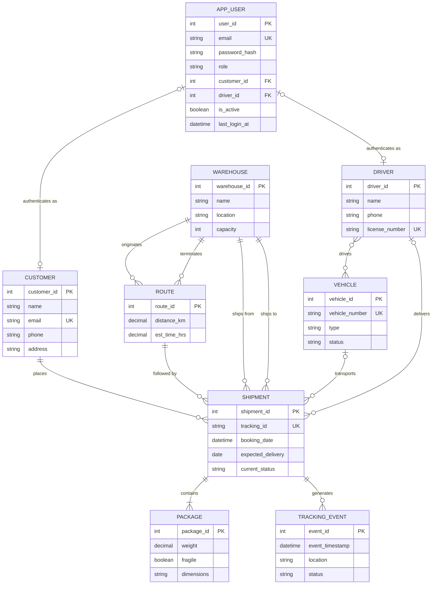

# Smart Logistics & Shipment Management System

A full-stack enterprise logistics and shipment tracking web application with role-based access control (RBAC), multi-party operational workflows, and dual-database architecture.

The platform coordinates logistics coordinators, fleet managers, field delivery partners, and customers across parcel booking, multi-package consignments, vehicle/driver assignment, real-time milestone transitions, and immutable audit logging.

Built as a **DBMS Course Mini-Project**, demonstrating 3NF relational database design, ACID transactions, polymorphic table linkages, triggers, database views, parameterized raw SQL without ORMs, and MongoDB hybrid audit logging.

---

## Table of Contents
- [Demo Credentials](#demo-credentials)
- [Architecture & Tech Stack](#architecture--tech-stack)
- [Role-Based Access Control (RBAC)](#role-based-access-control-rbac)
- [Permission Matrix](#permission-matrix)
- [Shipment Status Flow](#shipment-status-flow)
- [Entity-Relationship (ER) Diagram](#entity-relationship-er-diagram)
- [Relational Schema (3NF)](#relational-schema-3nf)
- [The Four Core DBMS Queries](#the-four-core-dbms-queries)
- [Local Setup (Under 5 Minutes)](#local-setup-under-5-minutes)
- [NPM Scripts](#npm-scripts)
- [Verification Suite](#verification-suite)

---

## Demo Credentials

The database seed script generates pre-configured demonstration accounts for each role:

| Role | Email | Password | Linked Profile / Scope |
|---|---|---|---|
| **Admin** | `admin@smartlogistics.com` | `Admin@123` | Full system access, all portals, users, and fleet |
| **Delivery Partner** | `rajesh.partner@smartlogistics.com` | `Partner@123` | Driver #1 (Rajesh Kumar), assigned deliveries |
| **Customer** | `aditi.sharma@example.com` | `Customer@123` | Customer #1 (Aditi Sharma), personal consignments |

*Note: Demo account chips appear on the login screen when `NEXT_PUBLIC_SHOW_DEMO_ACCOUNTS=true` for one-click testing.*

---

## Architecture & Tech Stack

| Layer | Technology | Purpose |
|---|---|---|
| **Frontend** | **Next.js 16 (App Router) + TypeScript** | React Server & Client Components, Responsive SaaS UI |
| **Styling** | **Tailwind CSS + CSS Variables** | Clean light palette (`#F8FAFC` base, `#FFFFFF` cards, `#E2E8F0` borders) |
| **Icons & Charts** | **Lucide React + Recharts** | Modern SVG icons and data visualization |
| **State & Cache** | **@tanstack/react-query** | Client query invalidation, caching, and optimistic mutations |
| **Validation** | **Zod + React Hook Form** | Shared runtime validation contracts across client and API |
| **Auth** | **JWT in httpOnly Cookie + bcryptjs** | Lightweight session management with two-layer defense |
| **Relational DB** | **MySQL 8.0 (`mysql2/promise`)** | Raw parameterized SQL, transactions, triggers, and views |
| **NoSQL DB** | **MongoDB 7.0 (`mongoose`)** | Immutable actor-aware activity logs and operational audit events |

---

## Role-Based Access Control (RBAC)

The application enforces a two-layer defense-in-depth security model:
1. **Edge Middleware (`middleware.ts`)**: Verifies JWT session cookie, redirects unauthenticated requests to `/login?next=...`, and routes users to their role portal.
2. **Route Handler Guards (`lib/auth/guards.ts`)**: Re-checks user status directly against MySQL `app_user` (`is_active = 1`, matching role) on every protected API call.
3. **Enumeration Protection**: If a customer or partner attempts to view a shipment not belonging to their scope, the API returns `404 NOT_FOUND` rather than `403`.

### Role Summaries

- **Admin (`/admin/*`)**:
  - Operational dashboard with throughput metrics, delayed consignment alerts, and status charts.
  - Full CRUD on shipments, customers, drivers, vehicles, warehouses, and routes.
  - Vehicle and driver assignment to booked shipments.
  - User management: create delivery partner accounts, toggle user active status, reset passwords.
  - Real-time MongoDB audit log viewer (`/admin/activity`).

- **Delivery Partner (`/partner/*`)**:
  - Dedicated partner hub showing assigned deliveries and vehicles.
  - Delivery progression: update checkpoints and advance shipment status (`PICKED_UP` -> `IN_TRANSIT` -> `AT_WAREHOUSE` -> `OUT_FOR_DELIVERY` -> `DELIVERED`).
  - Validation requires an assigned vehicle before advancing to `PICKED_UP`.
  - Delivery history archive and fleet vehicle specifications.

- **Customer (`/customer/*`)**:
  - Self-service consignment booking with automated route transit estimation.
  - Live timeline tracking with checkpoint milestones.
  - One-click cancellation for shipments in `BOOKED` status.
  - Personal shipment history and profile management.

- **Public Tracking (`/track/[trackingId]`)**:
  - Accessible without login.
  - Returns limited public fields only: tracking ID, current status, location, origin/destination hub names, expected delivery, and timeline.
  - Strictly hides private customer names, driver phone numbers, and vehicle registration numbers.

---

## Permission Matrix

| Endpoint / Operation | ADMIN | DELIVERY_PARTNER | CUSTOMER | PUBLIC |
|---|---|---|---|---|
| `GET /api/shipments` | All shipments | Assigned only (`driver_id = me`) | Own only (`customer_id = me`) | 401 |
| `POST /api/shipments` | Any customer | 403 | Own customer ID forced | 401 |
| `GET /api/shipments/:id` | Any | Assigned only (else 404) | Own only (else 404) | 401 |
| `PATCH /api/shipments/:id/assign` | Allowed | 403 | 403 | 401 |
| `POST /api/shipments/:id/events` | Any valid step | Assigned only (valid partner steps) | 403 | 401 |
| `POST /api/shipments/:id/cancel` | Any non-terminal | 403 | Own, `BOOKED` only | 401 |
| `GET /api/customers` | Full CRUD | 403 | 403 | 401 |
| `GET /api/drivers`, `/api/vehicles` | Full CRUD | 403 (use `/api/me/vehicles`) | 403 | 401 |
| `GET /api/warehouses`, `/api/routes` | Full CRUD | Read-only | Read-only (booking) | 401 |
| `GET /api/users`, `PATCH /api/users/:id` | Allowed | 403 | 403 | 401 |
| `GET /api/activity-logs` | Allowed | 403 | 403 | 401 |
| `GET /api/track/:trackingId` | Allowed | Allowed | Allowed | Limited fields only |

---

## Shipment Status Flow

Status transitions are governed by strict finite-state rules defined in `lib/shipment-flow.ts`:

```
BOOKED           -> PICKED_UP | CANCELLED
PICKED_UP        -> IN_TRANSIT
IN_TRANSIT       -> AT_WAREHOUSE | OUT_FOR_DELIVERY
AT_WAREHOUSE     -> IN_TRANSIT | OUT_FOR_DELIVERY
OUT_FOR_DELIVERY -> DELIVERED
DELIVERED, CANCELLED -> (terminal)
```

- Moving to `PICKED_UP` strictly requires both an assigned vehicle and driver.
- Invalid state transitions return `409 INVALID_TRANSITION` with the list of permitted next statuses.

---

## Entity-Relationship (ER) Diagram



---

## Relational Schema (3NF)

All relational tables are normalized to Third Normal Form (3NF):

- `app_user` (`user_id` PK, `email` UNIQUE, `password_hash`, `role` ENUM, `customer_id` FK, `driver_id` FK, `is_active`, `last_login_at`, `created_at`)
- `warehouse` (`warehouse_id` PK, `name`, `location`, `capacity`)
- `route` (`route_id` PK, `origin_warehouse_id` FK, `destination_warehouse_id` FK, `distance_km`, `est_time_hrs`)
- `vehicle` (`vehicle_id` PK, `vehicle_number` UNIQUE, `type` ENUM, `status` ENUM)
- `driver` (`driver_id` PK, `name`, `phone`, `license_number` UNIQUE)
- `driver_vehicle` (`driver_id` FK, `vehicle_id` FK, `assigned_on`, PRIMARY KEY (`driver_id`, `vehicle_id`))
- `customer` (`customer_id` PK, `name`, `email` UNIQUE, `phone`, `address`)
- `shipment` (`shipment_id` PK, `tracking_id` UNIQUE, `customer_id` FK, `route_id` FK, `origin_warehouse_id` FK, `destination_warehouse_id` FK, `vehicle_id` FK, `driver_id` FK, `booking_date`, `expected_delivery`, `current_status`)
- `package` (`package_id` PK, `shipment_id` FK, `weight`, `fragile`, `dimensions`)
- `tracking_event` (`event_id` PK, `shipment_id` FK, `event_timestamp`, `location`, `status`)

### Triggers & Views
- **Trigger `trg_app_user_role_bi`**: Enforces strict polymorphic integrity (e.g. `CUSTOMER` role must link to `customer_id`, `DELIVERY_PARTNER` must link to `driver_id`, `ADMIN` must link to neither).
- **Trigger `trg_after_tracking_event_insert`**: Automatically updates `shipment.current_status` upon insertion of any valid tracking event.
- **View `v_shipment_overview`**: Computes virtual field `is_delayed = 1` for active consignments exceeding `expected_delivery` and joins hub, vehicle, and driver details.

---

## The Four Core DBMS Queries

The application directly executes the four mandatory DBMS project queries:

### Query 1: Track Status and Location by Tracking ID
```sql
SELECT * FROM v_shipment_overview WHERE tracking_id = ?;
SELECT event_id, status, location, event_timestamp
FROM tracking_event WHERE shipment_id = ? ORDER BY event_timestamp ASC;
```

### Query 2: Filter Shipments by Vehicle, Driver, or Route
```sql
-- By Vehicle:
SELECT * FROM v_shipment_overview WHERE vehicle_id = ? ORDER BY booking_date DESC;
-- By Driver:
SELECT * FROM v_shipment_overview WHERE driver_id = ? ORDER BY booking_date DESC;
-- By Route:
SELECT * FROM v_shipment_overview WHERE route_id = ? ORDER BY booking_date DESC;
```

### Query 3: Delayed and Pending Shipments
```sql
-- Delayed consignments:
SELECT * FROM v_shipment_overview WHERE is_delayed = 1 ORDER BY expected_delivery ASC;
-- Pending consignments:
SELECT * FROM v_shipment_overview WHERE current_status IN ('BOOKED', 'PICKED_UP') ORDER BY expected_delivery ASC;
```

### Query 4: Customer Complete Shipment History
```sql
SELECT * FROM v_shipment_overview WHERE customer_id = ? ORDER BY booking_date DESC;
```

---

## Local Setup (Under 5 Minutes)

### 1. Prerequisites
- **Node.js** v20 or higher
- **MySQL 8.0**
- **MongoDB 7.0**

### 2. Install Dependencies
```bash
git clone https://github.com/abhiraamadiga/DBMS-mini-project.git
cd DBMS-mini-project
npm install
```

### 3. Environment Configuration
Create `.env.local` in the project root:
```env
MYSQL_HOST=localhost
MYSQL_PORT=3306
MYSQL_USER=root
MYSQL_PASSWORD=your_password
MYSQL_DATABASE=smart_logistics
MONGODB_URI=mongodb://localhost:27017/smart_logistics

AUTH_SECRET=smart_logistics_jwt_secret_key_minimum_32_characters_long
SESSION_COOKIE_NAME=slm_session
SESSION_DAYS=7
NEXT_PUBLIC_SHOW_DEMO_ACCOUNTS=true
```

### 4. Database Setup & Seeding
Run the automated database reset:
```bash
npm run db:reset
```
This drops existing tables, runs migrations (schema, views, triggers), and seeds:
- 1 Admin user, 8 Delivery Partner users, 15 Customer users
- 6 Warehouses, 10 Routes, 10 Vehicles, 8 Drivers
- 40 Shipments, 80+ Packages, and 150+ Tracking Events

### 5. Start Application
```bash
npm run dev
```
Open [http://localhost:3000](http://localhost:3000) in your browser.

---

## NPM Scripts

| Script | Command | Purpose |
|---|---|---|
| `dev` | `next dev` | Start local development server |
| `build` | `next build` | Validate type-safety and produce production bundle |
| `start` | `next start` | Start production server |
| `lint` | `next lint` | Run ESLint checks |
| `db:migrate` | `tsx db/migrate.ts` | Execute MySQL schema, views, and triggers |
| `db:seed` | `tsx db/seed/seed.ts` | Seed initial database accounts and sample records |
| `db:reset` | `tsx db/reset.ts` | Drop, migrate, and seed databases in one step |
| `verify:access` | `tsx scripts/verify-access.ts` | Automated RBAC and permission assertion suite |

---

## Verification Suite

To verify that all authorization guards, role boundaries, and enumeration protections are intact, run the automated verification suite against the running server:

```bash
npm run verify:access
```

This automated test asserts:
- Unauthenticated requests to protected endpoints return `401`.
- Public tracking returns limited fields only (hides personal names and vehicle numbers).
- Customer queries return only owned shipments; foreign shipments return `404`.
- Delivery partner queries return only assigned shipments; unauthorized actions return `403`/`404`.
- Admin has full access across all modules, user administration, and audit logs.
