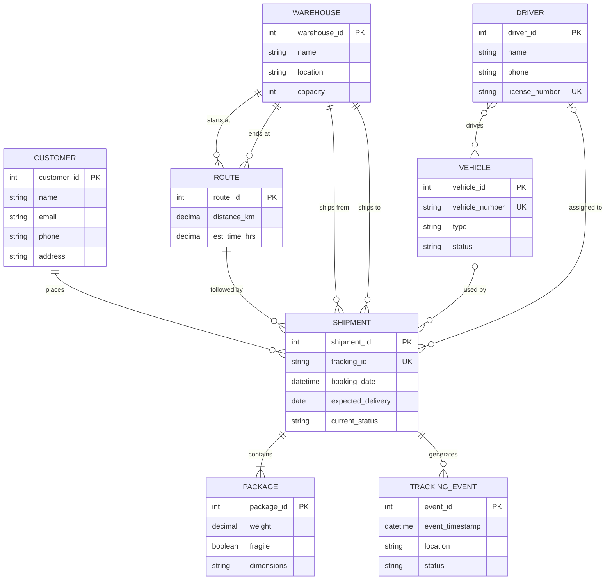

# Smart Logistics & Shipment Management System

[](https://nextjs.org/)
[](https://www.typescriptlang.org/)
[](https://www.mysql.com/)
[](https://www.mongodb.com/)
[](https://tailwindcss.com/)

A modern, full-stack logistics and shipment tracking web application engineered for logistics coordinators, dispatchers, fleet managers, and customers. The application centralizes customers, shipments, multi-package consignments, warehouses, routes, vehicles, drivers, and real-time checkpoint tracking events.

Built as a **DBMS Course Mini-Project**, demonstrating clean 3NF database design, transactions, automated triggers, database views, raw parameterized SQL without ORMs, and hybrid NoSQL audit logging.

---

## Table of Contents
- [Key Features](#key-features)
- [Architecture & Tech Stack](#architecture--tech-stack)
- [Entity-Relationship (ER) Diagram](#entity-relationship-er-diagram)
- [Relational Schema (3NF)](#relational-schema-3nf)
- [The Four Core DBMS Queries](#the-four-core-dbms-queries)
- [REST API Specifications](#rest-api-specifications)
- [Local Setup & Getting Started](#local-setup--getting-started)
- [Database Migrations & Seeding](#database-migrations--seeding)
- [UI Pages & Walkthrough](#ui-pages--walkthrough)

---

## Key Features

1. **End-to-End Shipment Lifecycle**:
   - Booking with route selection, dynamic multi-package items, weight calculations, fragile indicators, and automatic tracking ID generation (`SLM` + Year + 6-digit zero-padded sequence).
   - Single ACID transaction ensuring atomicity across shipment records, package rows, and initial `BOOKED` tracking events.

2. **Real-Time Checkpoint Tracking**:
   - Public tracking portal (`/` and `/track/[trackingId]`) requiring no authentication.
   - Milestone progression: `BOOKED` → `PICKED_UP` → `IN_TRANSIT` → `AT_WAREHOUSE` → `OUT_FOR_DELIVERY` → `DELIVERED` (or `CANCELLED`).
   - Automated MySQL trigger enforcing `shipment.current_status` updates on event insertion.
   - Guarded terminal states preventing new events on delivered or cancelled consignments.

3. **Fleet & Driver Assignment**:
   - Assign/reassign vehicles and certified drivers to active shipments.
   - Automatic validation preventing vehicles under `MAINTENANCE` from assignment.
   - M:N relationship tracking which drivers are authorized for specific vehicle types.

4. **Exception Handling & Proactive SLA Monitoring**:
   - View `v_shipment_overview` with calculated virtual column `is_delayed = 1` for shipments exceeding `expected_delivery`.
   - Dedicated dashboard widgets and filter tabs for **Delayed** and **Pending** consignments.

5. **Hybrid NoSQL Activity Auditing**:
   - MongoDB collection `activity_logs` recording non-blocking operational audit trails for creates, status transitions, and fleet assignments.

---

## Architecture & Tech Stack

| Layer | Technology | Purpose |
|---|---|---|
| **Frontend** | **Next.js 16 (App Router) + TypeScript** | React Server & Client Components, Responsive UI |
| **Styling** | **Tailwind CSS + CSS Variables** | Custom design tokens, dark/light theme switching |
| **Icons & Charts** | **Lucide React + Recharts** | Modern icons and SVG operational charts |
| **State & Fetching** | **@tanstack/react-query** | Client cache invalidation, live polling & mutations |
| **Form Validation**| **Zod + React Hook Form** | Shared schema validation across client and API |
| **Relational DB** | **MySQL 8.0 (`mysql2/promise`)** | Raw parameterized SQL, ACID transactions, views, triggers |
| **NoSQL DB** | **MongoDB 7.0 (`mongoose`)** | Append-only activity logs and operational audit events |

---

## Entity-Relationship (ER) Diagram



---

## Relational Schema (3NF)

All tables are normalized to Third Normal Form (3NF):

- `warehouse` (`warehouse_id` PK, `name`, `location`, `capacity`)
- `route` (`route_id` PK, `origin_warehouse_id` FK → warehouse, `destination_warehouse_id` FK → warehouse, `distance_km`, `est_time_hrs`)
- `vehicle` (`vehicle_id` PK, `vehicle_number` UNIQUE, `type` ENUM, `status` ENUM)
- `driver` (`driver_id` PK, `name`, `phone`, `license_number` UNIQUE)
- `driver_vehicle` (`driver_id` FK, `vehicle_id` FK, PRIMARY KEY (`driver_id`, `vehicle_id`))
- `customer` (`customer_id` PK, `name`, `email` UNIQUE, `phone`, `address`)
- `shipment` (`shipment_id` PK, `tracking_id` UNIQUE, `customer_id` FK, `route_id` FK, `origin_warehouse_id` FK, `destination_warehouse_id` FK, `vehicle_id` FK, `driver_id` FK, `booking_date`, `expected_delivery`, `current_status`)
- `package` (`package_id` PK, `shipment_id` FK, `weight`, `fragile`, `dimensions`)
- `tracking_event` (`event_id` PK, `shipment_id` FK, `event_timestamp`, `location`, `status`)

### Trigger & View
- **Trigger `trg_after_tracking_event_insert`**: Automatically updates `shipment.current_status` to match the newly inserted event status.
- **View `v_shipment_overview`**: Consolidates shipments, customer details, origin/destination hubs, assigned vehicles, drivers, latest locations, and computes `is_delayed`.

---

## The Four Core DBMS Queries

The application directly executes the four mandatory DBMS project queries:

### Query 1: Track Status and Location by Tracking ID
```sql
SELECT * FROM v_shipment_overview WHERE tracking_id = ?;
-- Followed by milestone history:
SELECT event_id, status, location, event_timestamp
FROM tracking_event WHERE shipment_id = ? ORDER BY event_timestamp ASC;
```

### Query 2: Filter Shipments by Vehicle, Driver, or Route
```sql
-- By Vehicle:
SELECT * FROM v_shipment_overview WHERE vehicle_id = ? ORDER BY booking_date DESC;
-- By Driver:
SELECT * FROM v_shipment_overview WHERE driver_id = ? ORDER BY booking_date DESC;
-- By Route:
SELECT * FROM v_shipment_overview WHERE route_id = ? ORDER BY booking_date DESC;
```

### Query 3: Delayed and Pending Shipments
```sql
-- Delayed consignments (past expected delivery & not delivered/cancelled):
SELECT * FROM v_shipment_overview WHERE is_delayed = 1 ORDER BY expected_delivery ASC;
-- Pending consignments (waiting for transit pickup):
SELECT * FROM v_shipment_overview WHERE current_status IN ('BOOKED', 'PICKED_UP') ORDER BY expected_delivery ASC;
```

### Query 4: Customer Complete Shipment History
```sql
SELECT * FROM v_shipment_overview WHERE customer_id = ? ORDER BY booking_date DESC;
```

---

## REST API Specifications

All endpoints return a uniform standard envelope:
```json
{
  "success": true,
  "data": {},
  "meta": { "page": 1, "limit": 10, "total": 40 }
}
```

| Resource | Method | Path | Description |
|---|---|---|---|
| **Shipments** | `GET` | `/api/shipments` | List with filters (`q`, `status`, `page`, `limit`) |
| | `POST` | `/api/shipments` | Transactional booking of shipment + packages |
| | `GET` | `/api/shipments/:id` | Detailed shipment with package list and timeline |
| | `PATCH` | `/api/shipments/:id/assign` | Assign vehicle or driver |
| | `POST` | `/api/shipments/:id/events` | Record milestone tracking event |
| | `GET` | `/api/shipments/delayed` | Delayed consignments query (Q3) |
| | `GET` | `/api/shipments/pending` | Pending consignments query (Q3) |
| **Tracking** | `GET` | `/api/track/:trackingId` | Public tracking endpoint (Q1) |
| **Customers** | `GET/POST` | `/api/customers` | List with search / Create customer |
| | `GET/PUT/DELETE`| `/api/customers/:id` | Read, update, or remove customer |
| | `GET` | `/api/customers/:id/shipments` | Customer shipment history (Q4) |
| **Vehicles** | `GET/POST` | `/api/vehicles` | Fleet listing and addition |
| | `GET` | `/api/vehicles/:id/shipments` | Shipments assigned to vehicle (Q2) |
| **Drivers** | `GET/POST` | `/api/drivers` | Driver directory and registration |
| | `GET` | `/api/drivers/:id/shipments` | Shipments assigned to driver (Q2) |
| **Routes** | `GET/POST` | `/api/routes` | Route connections between hubs |
| | `GET` | `/api/routes/:id/shipments` | Shipments assigned to route (Q2) |
| **Warehouses** | `GET/POST` | `/api/warehouses` | Warehouse hubs and capacity metrics |
| **Dashboard** | `GET` | `/api/dashboard/stats` | Aggregated analytics & operational charts |
| **Audit Logs** | `GET` | `/api/activity-logs?limit=20`| MongoDB activity feed logs |

---

## Local Setup & Getting Started

### 1. Prerequisites
- **Node.js** v20 or higher
- **MySQL 8.0**
- **MongoDB 7.0**

### 2. Clone and Configure
```bash
git clone https://github.com/abhiraamadiga/DBMS-mini-project.git
cd DBMS-mini-project
npm install
```

Copy the environment template:
```bash
cp .env.example .env.local
```

Ensure `.env.local` matches your local database credentials:
```env
MYSQL_HOST=localhost
MYSQL_PORT=3306
MYSQL_USER=root
MYSQL_PASSWORD=your_password
MYSQL_DATABASE=smart_logistics
MONGODB_URI=mongodb://localhost:27017/smart_logistics
```

*(Optional)* Run databases using Docker:
```bash
docker-compose up -d
```

---

## Database Migrations & Seeding

Reset database completely (drops, migrates, and inserts 40+ realistic shipments with history, delayed consignments, and MongoDB activity records):
```bash
npm run db:reset
```

Or run steps individually:
- `npm run db:migrate`: Executes SQL schema, views, and triggers.
- `npm run db:seed`: Seeds 15 customers, 6 warehouse hubs, 10 routes, 10 vehicles, 8 drivers, 40 shipments, 80+ packages, and 150+ tracking events.

### Starting the Web App
```bash
npm run dev
```
Visit [http://localhost:3000](http://localhost:3000) for the public tracking portal, and [http://localhost:3000/dashboard](http://localhost:3000/dashboard) for the operational admin dashboard.

---

## UI Pages & Walkthrough

1. **Public Tracking Landing Page (`/`)**:
   - Modern hero section with live tracking ID search input.
   - Quick test pill buttons to sample active consignments (`SLM2026000001`).
   - Feature highlight cards and direct link to the Admin Dashboard.

2. **Public Shipment Tracking (`/track/[trackingId]`)**:
   - Clean, standalone tracking page without admin navigation.
   - Origin-to-destination route banner, expected delivery date, delayed status warning.
   - Vertical animated tracking milestone timeline with timestamped checkpoints.
   - Consignment package list with weights and fragility indicators.

3. **Analytics Dashboard (`/dashboard`)**:
   - Key metric cards: Total Shipments, In Transit, Delivered, Delayed, Pending, Active Vehicles, Available Drivers.
   - 14-day daily shipment throughput area chart.
   - Consignment status breakdown donut chart.
   - Top 5 routes by volume horizontal bar chart.
   - Live MongoDB operational activity feed.

4. **Shipment Management (`/shipments`)**:
   - Filter chips for status, search bar, pagination controls.
   - Quick tabs for **All**, **Delayed**, and **Pending** consignments.

5. **Shipment Booking (`/shipments/new`)**:
   - Customer selection and route selection displaying distance and estimated transit hours.
   - Dynamic package item rows with real-time weight validation and fragile toggles.
   - Success screen presenting the newly generated Tracking ID with a single-click copy button.

6. **Shipment Detail (`/shipments/[id]`)**:
   - Assignment panel allowing vehicle and driver allocation.
   - "Add tracking event" modal for milestone location and status progression.

7. **Master Data Screens (`/customers`, `/vehicles`, `/drivers`, `/warehouses`, `/routes`)**:
   - Complete CRUD interfaces with modal dialogs and friendly foreign-key protection errors.
   - Customer shipment history view (`/customers/[id]`).
   - "View Shipments" slide-out drawer on Vehicles, Drivers, and Routes.
