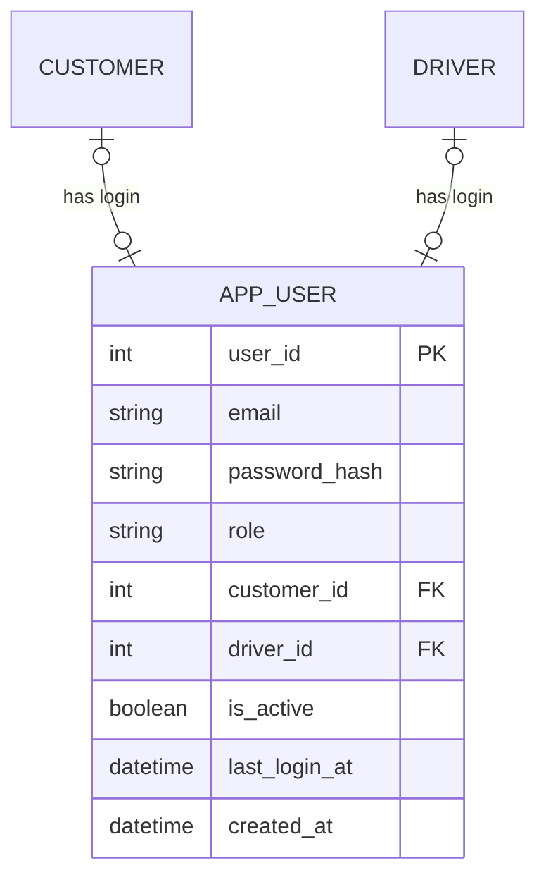

# ADDENDUM v2: Role-Based Login (Admin, Delivery Partner, Customer)

> **Instructions for the AI agent (read first)**
>
> - This addendum goes together with `SMART_LOGISTICS_PROJECT_SPEC.md` (the "base spec"). Read the base spec first, then this file.
> - Where the two conflict, **this addendum wins**. Specifically it **replaces** base spec section 12 (Commit Plan), extends sections 4-5 (schema), 7 (MongoDB), 9 (API), 10 (Frontend) and 11 (structure), and **removes authentication from Phase 2** (it is now part of Phase 1).
> - Everything not mentioned here stays exactly as in the base spec (same stack, same fonts, same design language, same seed rules unless extended below).
> - **Build PHASE 1 ONLY (revised Commits 1-9 in section 11 of this file).** Phase 2 (Commits 10-12) is listed for context only. **Do NOT start, scaffold or stub anything from Phase 2.**
> - One git commit per numbered commit with the exact message given. Do not squash or merge commits.
> - Security rules in section 3 are mandatory, not optional polish.

---

## 1. What changes

The app becomes a **multi-user system with three roles**. Every user logs in and lands in a portal built for their role, with separate navigation, pages and API permissions.

| Role | Who | How the account is created |
|---|---|---|
| **ADMIN** | Logistics company staff / shipment coordinator | Seeded (and can be created later by another admin) |
| **DELIVERY_PARTNER** | Driver who delivers shipments (linked to the `driver` table) | Created **by an admin** only |
| **CUSTOMER** | Sender who books shipments (linked to the `customer` table) | **Self-registration** at `/register` |

---

## 2. Database changes

### 2.1 ER update

Add one entity, `APP_USER`, with two optional 1:1 links:
- `CUSTOMER 1 --- 0..1 APP_USER` (a customer may have a login)
- `DRIVER 1 --- 0..1 APP_USER` (a driver may have a login)
- An ADMIN user links to neither.

Add to the Mermaid diagram in `docs/er-diagram.md`:



Relational schema line to add to `docs/er-diagram.md`:
```
app_user(user_id PK, email UNIQUE, password_hash, role, customer_id FK NULL UNIQUE,
         driver_id FK NULL UNIQUE, is_active, last_login_at, created_at)
```

### 2.2 DDL (append to `db/mysql/01_schema.sql`, after `customer` and `driver` exist)

```sql
CREATE TABLE app_user (
  user_id       INT UNSIGNED AUTO_INCREMENT PRIMARY KEY,
  email         VARCHAR(120) NOT NULL UNIQUE,
  password_hash VARCHAR(100) NOT NULL,                       -- bcrypt hash only, never plaintext
  role          ENUM('ADMIN','DELIVERY_PARTNER','CUSTOMER') NOT NULL,
  customer_id   INT UNSIGNED NULL UNIQUE,
  driver_id     INT UNSIGNED NULL UNIQUE,
  is_active     BOOLEAN NOT NULL DEFAULT TRUE,
  last_login_at DATETIME NULL,
  created_at    DATETIME NOT NULL DEFAULT CURRENT_TIMESTAMP,
  CONSTRAINT fk_user_customer FOREIGN KEY (customer_id) REFERENCES customer(customer_id) ON DELETE CASCADE,
  CONSTRAINT fk_user_driver   FOREIGN KEY (driver_id)   REFERENCES driver(driver_id)     ON DELETE CASCADE,
  INDEX idx_user_role (role)
) ENGINE=InnoDB;
```

### 2.3 Role-consistency trigger (append to `db/mysql/02_views_triggers.sql`, separated by `-- @@`)

Enforces that each role links to the right table (done in the DB, not only the API):

```sql
CREATE TRIGGER trg_app_user_role_bi
BEFORE INSERT ON app_user
FOR EACH ROW
BEGIN
  IF NEW.role = 'CUSTOMER' AND (NEW.customer_id IS NULL OR NEW.driver_id IS NOT NULL) THEN
    SIGNAL SQLSTATE '45000' SET MESSAGE_TEXT = 'CUSTOMER user must link to exactly one customer';
  ELSEIF NEW.role = 'DELIVERY_PARTNER' AND (NEW.driver_id IS NULL OR NEW.customer_id IS NOT NULL) THEN
    SIGNAL SQLSTATE '45000' SET MESSAGE_TEXT = 'DELIVERY_PARTNER user must link to exactly one driver';
  ELSEIF NEW.role = 'ADMIN' AND (NEW.customer_id IS NOT NULL OR NEW.driver_id IS NOT NULL) THEN
    SIGNAL SQLSTATE '45000' SET MESSAGE_TEXT = 'ADMIN user must not link to a customer or driver';
  END IF;
END
```
(The API must never change `role`, `customer_id` or `driver_id` of an existing user.)

> **Known MySQL gotcha:** if the base spec's `CHECK` constraints on FK columns (e.g. `chk_route_endpoints`) are rejected with error 3823, remove that one `CHECK` and enforce the rule in the API instead. Do not weaken anything else.

### 2.4 Seed users (extend `db/seed/seed.ts`; hash with bcrypt at seed time)

| Role | Count | Email | Password |
|---|---|---|---|
| ADMIN | 1 | `admin@smartlogistics.com` | `Admin@123` |
| DELIVERY_PARTNER | 8 (one per seeded driver) | `<firstname>.partner@smartlogistics.com` | `Partner@123` |
| CUSTOMER | all 15 seeded customers (use `customer.email`) | their email | `Customer@123` |

**Seed data additions so every portal has something to show**
- Every driver has **at least 3 assigned shipments** with a mix of statuses; at least 2 drivers have a shipment in `OUT_FOR_DELIVERY` and at least 1 has a delayed shipment.
- Every shipment that is not `BOOKED` or `CANCELLED` has both a `vehicle_id` and a `driver_id`. `BOOKED` shipments may be unassigned (so the admin has something to assign).
- At least 2 shipments are in `BOOKED` status for a customer who can then cancel them in the demo.
- Keep one customer with 0 shipments (empty state) and one with 5+ (history).
- Print the demo credentials table at the end of `npm run db:seed`.

---

## 3. Authentication and security (mandatory)

**Approach:** lightweight custom auth, no heavy framework.
- Libraries: `bcryptjs` (hashing), `jose` (JWT, works in Next.js middleware).
- Session = signed **JWT in an `httpOnly` cookie** (`sameSite=lax`, `secure` in production, 7-day expiry, name from env).
- JWT payload: `{ sub: userId, role, name, customerId?, driverId? }`.
- Passwords: bcrypt cost 10-12. Rules: minimum 8 characters, at least one letter and one number (zod). Never return or log `password_hash`.
- Login failures always return the same message: `Invalid email or password` (no user enumeration). Deactivated accounts get `Account disabled. Contact admin.`
- **Rate limit** login: max 5 failed attempts per 15 minutes per email+IP (simple in-memory limiter in `lib/auth/rate-limit.ts` is enough). Return 429.
- Update `last_login_at` on successful login.
- **Defense in depth, two layers:**
  1. **Middleware** (`middleware.ts`): verifies the JWT cookie, redirects unauthenticated users to `/login?next=<path>`, and redirects a logged-in user who opens another role's area (e.g. a customer opening `/admin/...`) to their own home.
  2. **Route-handler guards**: every protected API handler calls `requireAuth([...roles])`, which verifies the JWT and **re-checks the user row in MySQL** (`is_active`, role) so deactivation takes effect immediately. Never rely on middleware alone.
- **Ownership returns 404, not 403.** If a customer or partner requests a shipment they do not own, respond `404 NOT_FOUND` (prevents record enumeration). Use 401 for "not logged in" and 403 for "logged in but wrong role".
- **Data scoping is enforced in SQL, never in the UI.** Provide a helper:

```ts
// lib/auth/guards.ts
requireAuth(roles?: Role[]): Promise<Session>               // throws ApiError 401 / 403
shipmentScope(s: Session): { customerId?: number; driverId?: number }
// ADMIN -> {} (no filter) | CUSTOMER -> { customerId } | DELIVERY_PARTNER -> { driverId }
```
Every shipment query in `lib/queries/shipments.ts` accepts `scope` and appends `AND s.customer_id = ?` or `AND s.driver_id = ?`. Query-string filters from the client (`customerId`, `driverId`) are **ignored/overridden** for non-admins.

- Env additions: `AUTH_SECRET` (min 32 chars), `SESSION_COOKIE_NAME=slm_session`, `SESSION_DAYS=7`, `NEXT_PUBLIC_SHOW_DEMO_ACCOUNTS=true`.
- Logout clears the cookie. Passwords can be changed only with the current password.

---

## 4. Features per role

### 4.1 ADMIN portal (`/admin/...`)

Full control of the system.

| Feature | Details |
|---|---|
| Dashboard | All stat cards and charts from the base spec (totals, delayed, pending, per-status donut, per-day area chart, top routes, recent activity) |
| Shipments | See **all** shipments; filters, Delayed and Pending tabs, search; create a booking **on behalf of any customer**; assign / re-assign **vehicle and driver**; add tracking events; cancel any non-terminal shipment |
| Customers | CRUD + per-customer shipment history (Q4) |
| Delivery Partners (drivers) | CRUD + view assigned shipments (Q2) + link to vehicles (DRIVES) |
| Vehicles, Warehouses, Routes | CRUD (+ "View shipments" for vehicles and routes, Q2) |
| **Users and Access** | List all users (email, role, linked person, active, last login); **create a Delivery Partner account** (creates the `driver` row and the `app_user` row in one transaction, or attach a login to an existing driver without one); activate / deactivate a user; **reset a user's password** (admin enters a temporary password); an admin cannot deactivate themselves, and the last active admin can never be deactivated |
| Activity Log | Full Mongo `activity_logs` feed with actor and role |

### 4.2 DELIVERY PARTNER portal (`/partner/...`)

Sees **only** shipments where `driver_id` = their own driver id.

| Feature | Details |
|---|---|
| Dashboard | Greeting, cards: Assigned, In Transit, Out for Delivery, Delivered Today, Delayed; **"Today's deliveries"** list sorted by expected date; assigned vehicle card |
| My Deliveries | Table of assigned shipments with status filter chips and search by tracking ID |
| Delivery detail | Shipment info (tracking ID, origin to destination, packages with weight and a **FRAGILE** warning badge, customer name and phone, expected delivery, delayed badge), timeline, and a **"Update status"** panel (see transition rules below) with location input (suggest warehouse locations, free text allowed) |
| Delivery History | Completed (`DELIVERED`) shipments with delivered date |
| My Vehicle | Read-only list of vehicles linked to them via `driver_vehicle` (number, type, status) |
| Profile | View name, phone, licence number; change password |

A partner **cannot**: see other drivers' shipments, reassign anything, cancel a shipment, book shipments, or see the admin pages (API returns 404/403, UI hides links).

### 4.3 CUSTOMER portal (`/customer/...`)

Sees **only** shipments where `customer_id` = their own customer id.

| Feature | Details |
|---|---|
| Dashboard | Greeting, cards: Total, Active, Delivered, Delayed; **active shipments with mini progress bar** (status steps); recent shipments |
| Book Shipment | Choose route (shows origin, destination, distance, ETA), add packages (weight, fragile toggle, dimensions), submit. `customer_id` is **forced from the session**. `expected_delivery` is **computed by the server** = today + `CEIL(est_time_hrs / 24)` + 1 buffer day (admin may override; customer may not). Success dialog shows the new tracking ID with a copy button |
| My Shipments | Complete history (Q4) with status filters, search, pagination |
| Shipment detail | Summary, vertical timeline, packages, expected delivery, delayed warning; assigned driver **name only** (no phone) and vehicle type |
| Cancel | Allowed **only while status is `BOOKED`** and only for own shipment. Writes a `CANCELLED` tracking event |
| Track | Same public tracking page, with a quick "my shipments" shortcut |
| Profile | Edit name, phone, address (email read-only); change password |

A customer **cannot**: see other customers' shipments, assign vehicles or drivers, add tracking events, or see admin or partner pages.

### 4.4 Common to all roles
- `/login`, `/register` (customer only), logout, change password, profile.
- After login redirect by role: Admin to `/admin/dashboard`, Delivery Partner to `/partner/dashboard`, Customer to `/customer/dashboard` (honor `?next=` only if it belongs to that role's area).
- **Public tracking** (`/track/[trackingId]`, `GET /api/track/:trackingId`) stays open to anyone who knows a tracking ID, but returns **limited data only**: tracking ID, current status, current location, origin and destination location names, expected delivery, delayed flag, timeline (status, location, time), package count. **No** customer details, driver details, phone numbers or vehicle numbers.

---

## 5. Shipment status transition rules (replaces base rule 6)

```
BOOKED           -> PICKED_UP | CANCELLED*
PICKED_UP        -> IN_TRANSIT
IN_TRANSIT       -> AT_WAREHOUSE | OUT_FOR_DELIVERY
AT_WAREHOUSE     -> IN_TRANSIT | OUT_FOR_DELIVERY
OUT_FOR_DELIVERY -> DELIVERED
DELIVERED, CANCELLED -> (terminal, no further events)
```
- **Partner** may set: `PICKED_UP`, `IN_TRANSIT`, `AT_WAREHOUSE`, `OUT_FOR_DELIVERY`, `DELIVERED` (only valid next steps, only on own assigned shipments).
- **Admin** may set any valid next step, and may set `CANCELLED` from any non-terminal status.
- **Customer** may only cancel, and only from `BOOKED` (`*`).
- A shipment **cannot move to `PICKED_UP`** unless it has both a vehicle and a driver assigned (409 with a clear message).
- Invalid transitions return `409 INVALID_TRANSITION` with the list of allowed next statuses. Put the transition map in one file, `lib/shipment-flow.ts`, used by both the API and the UI (the UI only shows buttons for allowed next steps).

---

## 6. API additions and permissions

### 6.1 New endpoints

| Endpoint | Access | Purpose |
|---|---|---|
| `POST /api/auth/login` | public | email + password, sets cookie |
| `POST /api/auth/register` | public | **customer self-registration** (creates `customer` + `app_user` in one transaction, auto-login) |
| `POST /api/auth/logout` | any logged in | clears cookie |
| `GET /api/auth/me` | any logged in | current user + role + linked names |
| `POST /api/auth/change-password` | any logged in | needs current password |
| `GET/POST /api/users`, `PATCH /api/users/:id` (activate/deactivate), `POST /api/users/:id/reset-password` | ADMIN | Users and Access |
| `GET /api/me/dashboard` | CUSTOMER, DELIVERY_PARTNER | role-specific stats (scoped) |
| `GET/PUT /api/me/profile` | CUSTOMER, DELIVERY_PARTNER (partner read-only except password) | own profile |
| `GET /api/me/vehicles` | DELIVERY_PARTNER | vehicles linked through `driver_vehicle` |
| `POST /api/shipments/:id/cancel` | ADMIN, CUSTOMER (own, `BOOKED` only) | cancel with event |

### 6.2 Permission matrix for existing endpoints

| Endpoint | ADMIN | DELIVERY_PARTNER | CUSTOMER |
|---|---|---|---|
| `GET /api/shipments` | all | forced `driver_id = me` | forced `customer_id = me` |
| `POST /api/shipments` | any customer (may override expected date) | no (403) | yes, `customer_id` forced to self, expected date server-computed |
| `GET /api/shipments/:id` | any | only if assigned to me, else 404 | only if mine, else 404 |
| `PATCH /api/shipments/:id/assign` | yes | no | no |
| `GET /api/shipments/:id/events` | any | assigned only | own only |
| `POST /api/shipments/:id/events` | any valid step | assigned only, partner-allowed steps | no |
| `GET /api/shipments/delayed`, `/pending` | all | scoped to me | scoped to me |
| `GET /api/customers`, `/:id`, `/:id/shipments` | yes | no | no (use `/api/me`) |
| `POST/PUT/DELETE` customers, drivers, vehicles, warehouses, routes | yes | no | no |
| `GET /api/drivers`, `/api/vehicles` (+ `/:id/shipments`) | yes | no (use `/api/me/vehicles`) | no |
| `GET /api/warehouses`, `GET /api/routes` (list/read) | yes | yes (read-only) | yes (read-only, needed for booking form) |
| `GET /api/dashboard/stats` | yes | no (use `/api/me/dashboard`) | no (use `/api/me/dashboard`) |
| `GET /api/activity-logs` | yes | no | no |
| `GET /api/track/:trackingId` | public, limited fields | public | public |

All responses keep the standard envelope from the base spec. Add error codes `UNAUTHENTICATED` (401), `FORBIDDEN` (403), `RATE_LIMITED` (429), `INVALID_TRANSITION` (409).

---

## 7. MongoDB addition

Extend `activity_logs` with an `actor` field and log auth events:

```json
{
  "action": "LOGIN | LOGOUT | REGISTERED | USER_CREATED | USER_DEACTIVATED | PASSWORD_RESET | SHIPMENT_CREATED | STATUS_UPDATED | SHIPMENT_CANCELLED | VEHICLE_ASSIGNED | DRIVER_ASSIGNED | ...",
  "actor": { "userId": 3, "role": "DELIVERY_PARTNER", "name": "Ravi Kumar" },
  "entity": "shipment",
  "entityId": 42,
  "trackingId": "SLM2026000042",
  "details": { "from": "IN_TRANSIT", "to": "OUT_FOR_DELIVERY", "location": "Bengaluru Hub" },
  "createdAt": "ISODate"
}
```
Never store passwords, hashes or tokens in logs. Log writes must never break the main request (try/catch). Admin sees all logs; customers and partners see none (their own shipment timeline comes from MySQL).

---

## 8. Frontend additions

### 8.1 Route map (replaces the `(admin)` group in the base spec)

```
app/
├── (public)/page.tsx                      # landing (shows "Go to dashboard" if logged in)
├── (public)/track/[trackingId]/page.tsx   # public, limited data
├── (auth)/login/page.tsx
├── (auth)/register/page.tsx               # customers only
├── admin/        layout.tsx  dashboard  shipments(+new,[id])  customers(+[id])  drivers  vehicles  warehouses  routes  users  activity
├── partner/      layout.tsx  dashboard  deliveries(+[id])  history  vehicle  profile
├── customer/     layout.tsx  dashboard  book  shipments(+[id])  profile
└── api/...
```
Reuse components across portals (`StatusBadge`, `DataTable`, `ShipmentTimeline`, `ShipmentCard`, `PackageList`), but each portal has its **own layout and sidebar** with only its own links.

### 8.2 Navigation per role

| Role | Sidebar |
|---|---|
| Admin | Dashboard, Shipments, Customers, Delivery Partners, Vehicles, Warehouses, Routes, Users and Access, Activity Log |
| Delivery Partner | Dashboard, My Deliveries, Delivery History, My Vehicle, Profile |
| Customer | Dashboard, Book Shipment, My Shipments, Profile (plus a "Track a shipment" search in the top bar) |

### 8.3 Login and register pages (make them look great)
- **Split-screen layout:** left panel with a gradient (indigo to cyan), logo, tagline and a CSS/SVG illustration or animated route line (no external images); right panel with the form card.
- Fields: email, password with **show/hide toggle**, "Sign in" button with loading state; inline zod errors; error shake animation with framer-motion on failed login.
- **Demo accounts** (only when `NEXT_PUBLIC_SHOW_DEMO_ACCOUNTS=true`): three clickable chips (Admin, Delivery Partner, Customer) that auto-fill the form with the seeded credentials. This is for the project demo and viva.
- `/register`: name, email, phone, address, password, confirm password (strength hint), link back to login.
- Top bar in every portal: global tracking-ID search, theme toggle, **user menu** (initials avatar, name, **role badge**, Profile, Logout). Role badge colors: Admin purple, Delivery Partner amber, Customer cyan.
- Friendly `403`/`404` pages and a session-expired toast that redirects to `/login`.
- Use the same fonts, palette, dark/light theme, skeletons, empty states and toasts defined in the base spec.

---

## 9. Verification script (small but impressive for a viva)

Add `scripts/verify-access.ts` with `npm run verify:access`. With the dev server running, it logs in as the seeded admin, partner and customer and asserts expected HTTP codes, e.g.:
- customer `GET /api/shipments` returns only own shipments; customer `GET /api/customers` returns 403; customer opening another customer's shipment returns 404
- partner `GET /api/shipments` returns only assigned shipments; partner `POST /api/shipments/:id/events` on someone else's shipment returns 404; partner trying `CANCELLED` returns 409/403
- admin can do all of the above
- unauthenticated `GET /api/shipments` returns 401; public `GET /api/track/:id` returns limited fields only (no `customer_name`, `driver_name`, `vehicle_number`)

Print a pass/fail table. Exit code 1 on any failure.

---

## 10. Dependencies to add
`bcryptjs`, `jose` (and `@types/bcryptjs`). No other auth library.

---

## 11. REVISED COMMIT PLAN (replaces base spec section 12)

12 commits total: **9 = Phase 1 (75%)**, **3 = Phase 2 (25%)**. Authentication is now part of Phase 1.

### PHASE 1 (BUILD THESE)

**Commit 1** `chore: scaffold Next.js app with Tailwind, shadcn/ui and project structure`
- As in base spec, plus install `bcryptjs` and `jose`, add the new env vars to `.env.example`, create the role-based folder structure (`admin/`, `partner/`, `customer/`, `(auth)/`).
- Done when: `npm run dev` shows a styled placeholder page with correct fonts.

**Commit 2** `feat(db): add MySQL schema with app_user, views, triggers, connection layer and seed data`
- Base schema, view and `trg_tracking_event_after_insert`, plus `app_user`, `trg_app_user_role_bi` (sections 2.2-2.3), updated `docs/er-diagram.md`, `lib/db/mysql.ts`, `lib/db/mongo.ts`, `ActivityLog` model, migrate and seed scripts including **seed users** (2.4), `db:reset`.
- Done when: `npm run db:reset` gives the base row counts plus 1 admin, 8 partner and 15 customer users, prints the demo credentials, and the trigger rejects a mismatched role/link insert.

**Commit 3** `feat(auth): add JWT session auth, role guards, data scoping and user management API`
- `lib/auth/*` (hash, session, guards, rate limit), `middleware.ts`, auth endpoints, `/api/users` endpoints, `shipmentScope`, `lib/shipment-flow.ts`, error codes.
- Done when: login/logout/register/me/change-password work, wrong-role access is blocked, and the rate limiter returns 429 after 5 bad attempts.

**Commit 4** `feat(api): add role-guarded CRUD for customers, warehouses, routes, vehicles and drivers`
- Zod validators, queries, pagination and search, 409 mapping, permission matrix 6.2 applied to these resources.
- Done when: admin has full CRUD; other roles get 403 (or read-only where the matrix says so).

**Commit 5** `feat(api): add role-scoped shipment, tracking, cancel and dashboard endpoints`
- Transactional `POST /api/shipments` (customer vs admin behavior), assign, events with transition rules (section 5), cancel, Q1-Q4, delayed/pending, public limited `GET /api/track/:id`, `/api/me/*`, `/api/dashboard/stats`.
- Done when: Q1-Q4 work and every row of matrix 6.2 for shipments behaves as specified.

**Commit 6** `feat(ui): add login, register, role-based layouts, landing page and admin dashboard`
- `/login` (with demo account chips), `/register`, middleware redirects, the three portal layouts and sidebars, user menu, `/` landing, public `/track/[trackingId]`, and the full `/admin/dashboard`.
- Done when: each demo account lands in the correct portal, wrong-area URLs redirect, dark/light works.

**Commit 7** `feat(ui): add shipments module for admin and customer, plus customer portal`
- Shared shipment components; admin `/admin/shipments` (+new, [id] with assign panel and events dialog); customer `/customer/dashboard`, `/customer/book`, `/customer/shipments` (+[id], cancel), `/customer/profile`.
- Done when: a customer can register, book, see the tracking ID, view the timeline and cancel a `BOOKED` shipment; admin can assign a vehicle/driver to it.

**Commit 8** `feat(ui): add delivery partner portal, admin master-data screens and user management`
- `/partner/*` (dashboard, deliveries, delivery detail with status update panel, history, vehicle, profile); admin `customers`, `drivers`, `vehicles`, `warehouses`, `routes`, `users` pages with dialog forms and "View shipments" drawers.
- Done when: a partner can walk a shipment from `PICKED_UP` to `DELIVERED` using only allowed steps; admin can create a partner account and deactivate a user.

**Commit 9** `feat(mongo): add actor-aware activity logs, access verification script and finalize Phase 1 docs`
- Activity logging with `actor` for all key actions (section 7), `/admin/activity`, `scripts/verify-access.ts` (section 9), README (setup, env, scripts, ER diagram, demo accounts table, role feature summary, permission matrix), final QA: `npm run build` passes, lint clean, no console errors.
- Done when: `npm run verify:access` passes fully and a fresh clone runs by following the README only.

> **STOP after Commit 9. Do not continue into Phase 2.**

### PHASE 2 (DO NOT BUILD YET, 25%, next week)

**Commit 10** `feat(telemetry): add partner location sharing, MongoDB vehicle telemetry and live map`
- `vehicle_telemetry` collection (TTL + 2dsphere), partner "share my location" button posting pings, Leaflet live map for admin and for customers on their own active shipments.

**Commit 11** `feat(reports): add role-aware reports, exports and notifications`
- CSV/PDF exports, delivery-performance report (admin), earnings/delivery summary (partner), in-app notifications on status changes (customer).

**Commit 12** `feat(release): add deployment config, security hardening and final polish`
- Vercel + managed MySQL + Atlas guide, security headers, final UI polish, demo script.

---

## 12. Phase 1 Definition of Done (checklist)

- [ ] 9 commits exist, exactly matching section 11
- [ ] `app_user` table and role trigger exist; seed creates 1 admin, 8 partners, 15 customers with the documented credentials
- [ ] Login, logout, customer registration, change password all work; passwords are bcrypt-hashed
- [ ] Middleware **and** API guards both enforce roles; non-owners get 404 on other people's shipments
- [ ] Each role sees only its own portal, navigation and data (verified by `npm run verify:access`)
- [ ] Customer can register, book, track, cancel a `BOOKED` shipment; partner can advance status through valid steps only; admin can assign vehicles/drivers and manage users
- [ ] Public tracking shows limited fields only
- [ ] Activity logs in MongoDB include actor and role and appear in the admin Activity Log
- [ ] Login and register pages are polished (split layout, demo account chips, animations)
- [ ] `npm run build` passes; README lets a stranger run the project in under 5 minutes
- [ ] **No Phase 2 code exists in the repo**
