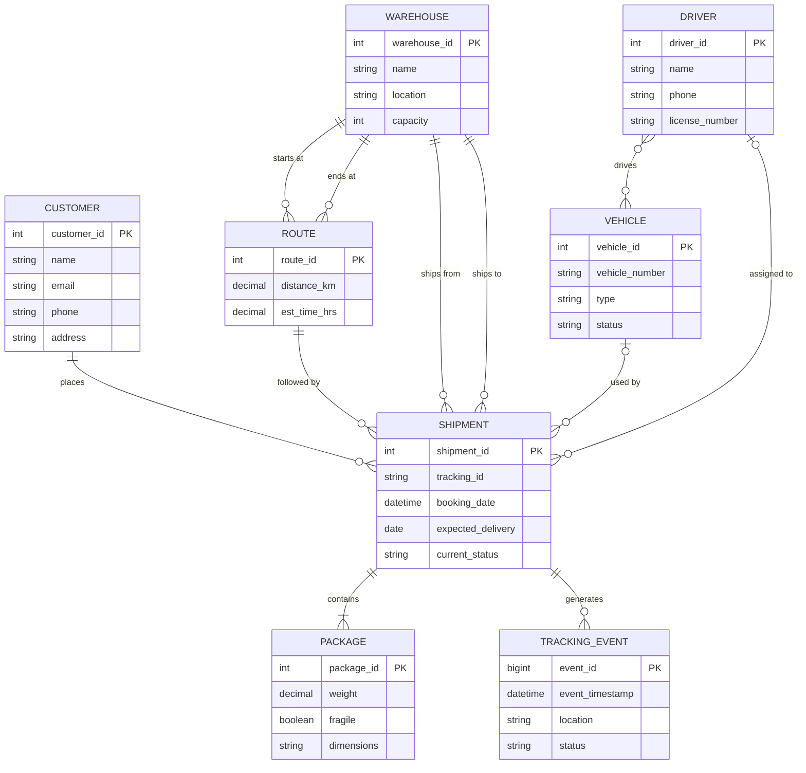

# Smart Logistics & Shipment Management System

> **Instructions for the AI agent (read first)**
>
> - This document is the single source of truth. Build the app exactly as specified.
> - **Build PHASE 1 ONLY (Commits 1-9).** Phase 2 (Commits 10-12) is listed at the end for context. **Do NOT start, scaffold, or stub anything from Phase 2** until the user explicitly asks next week.
> - Make **one git commit per numbered commit** below, using the exact Conventional Commit message given. Do not squash. Do not merge commits together.
> - Keep it simple and clean, not over-engineered. No ORMs. Use raw parameterized SQL via `mysql2` (this is a DBMS course project, so the SQL must be visible and readable).
> - After each commit, the app must still run (`npm run dev`) with no errors.
> - Never hardcode secrets. Use `.env.local` and commit only `.env.example`.

---

## 1. Project Overview

**Title:** Smart Logistics & Shipment Management System

A web application that helps logistics companies, shipment coordinators, warehouse staff, delivery agents and customers manage goods moving from sender to receiver. It centralizes customers, shipments, packages, warehouses, vehicles, drivers, routes and tracking events, and gives real-time shipment status.

### Key queries the database MUST support
1. Track the **current status and location** of a shipment using its **tracking ID**.
2. Find all shipments assigned to a particular **vehicle**, **driver**, or **route**.
3. Identify **delayed or pending** shipments using the **expected delivery date**.
4. Retrieve a **customer's complete shipment history** and delivery status.

---

## 2. Tech Stack (final, do not substitute)

| Layer | Choice |
|---|---|
| Frontend | **Next.js** (latest stable, App Router) + **TypeScript** |
| Backend / API | **Next.js Route Handlers** (`app/api/**/route.ts`) |
| SQL database | **MySQL 8** (via `mysql2/promise` connection pool, raw SQL) |
| NoSQL database | **MongoDB** (via `mongoose`) for activity logs (Phase 1) and telemetry (Phase 2) |
| Version control | **Git + GitHub** |

### Frontend libraries (to make it look polished)
- **Tailwind CSS** + **shadcn/ui** (Radix-based components): cards, tables, dialogs, forms, tabs, badges, dropdowns, skeletons
- **lucide-react** icons
- **Recharts** for dashboard charts
- **framer-motion** for subtle page and card animations
- **sonner** for toasts
- **next-themes** for light/dark mode
- **react-hook-form** + **zod** for forms and validation
- **@tanstack/react-query** for data fetching and caching
- **date-fns** for dates

### Fonts (load with `next/font/google`)
- **Headings:** `Plus Jakarta Sans` (600/700/800)
- **Body/UI:** `Inter`
- **Tracking IDs, vehicle numbers, code:** `JetBrains Mono`

### Backend / tooling libraries
`mysql2`, `mongoose`, `zod`, `dotenv`, `tsx` (to run seed/migrate scripts)

### Optional local infra
Provide a `docker-compose.yml` that starts MySQL 8 and MongoDB 7 so the project runs with one command. The user may instead use local installs or MongoDB Atlas.

---

## 3. ER Diagram

### 3.1 Interpretation of the submitted ER diagram

**Entities and attributes**

| Entity | Attributes |
|---|---|
| CUSTOMER | customer_id (PK), name, email, phone, address |
| SHIPMENT | shipment_id (PK), tracking_id, booking_date, expected_delivery, current_status |
| PACKAGE | package_id (PK), weight, fragile, dimensions |
| WAREHOUSE | warehouse_id (PK), name, location, capacity |
| ROUTE | route_id (PK), distance_km, est_time_hrs |
| VEHICLE | vehicle_id (PK), vehicle_number, type, status |
| DRIVER | driver_id (PK), name, phone, license_number |
| TRACKING_EVENT | event_id (PK), event_timestamp, location, status |

**Relationships**

| Relationship | Entities | Cardinality |
|---|---|---|
| PLACES | CUSTOMER - SHIPMENT | 1 : N |
| FOLLOWS | SHIPMENT - ROUTE | N : 1 |
| SHIPS FROM | SHIPMENT - WAREHOUSE (origin) | N : 1 |
| SHIPS TO | SHIPMENT - WAREHOUSE (destination) | N : 1 |
| CONNECTS | ROUTE - WAREHOUSE (origin and destination) | N : 1 each |
| CONTAINS | SHIPMENT - PACKAGE | 1 : N |
| GENERATES | SHIPMENT - TRACKING_EVENT | 1 : N |
| USES | SHIPMENT - VEHICLE | N : 1 (optional until assigned) |
| ASSIGNED TO | SHIPMENT - DRIVER | N : 1 (optional until assigned) |
| DRIVES | DRIVER - VEHICLE | M : N |

### 3.2 Mermaid ER diagram (render in GitHub; also show in the README)



---

## 4. ER to Relational Schema Conversion

| Rule applied | Result |
|---|---|
| Strong entity becomes a table | `customer`, `shipment`, `package`, `warehouse`, `route`, `vehicle`, `driver`, `tracking_event` |
| 1:N puts FK on the "many" side | `shipment.customer_id`, `package.shipment_id`, `tracking_event.shipment_id`, `shipment.route_id` |
| Two relationships to the same entity use two FKs | `shipment.origin_warehouse_id` / `destination_warehouse_id`; `route.origin_warehouse_id` / `destination_warehouse_id` |
| Optional N:1 uses a nullable FK | `shipment.vehicle_id`, `shipment.driver_id` |
| M:N becomes a junction table | `driver_vehicle (driver_id, vehicle_id)` for DRIVES |

### Relational schema (PK underlined by convention, FK marked)

```
customer(customer_id PK, name, email UNIQUE, phone, address, created_at)
warehouse(warehouse_id PK, name, location, capacity)
route(route_id PK, origin_warehouse_id FK, destination_warehouse_id FK, distance_km, est_time_hrs)
vehicle(vehicle_id PK, vehicle_number UNIQUE, type, status)
driver(driver_id PK, name, phone, license_number UNIQUE)
driver_vehicle(driver_id FK, vehicle_id FK, assigned_on)   PK(driver_id, vehicle_id)
shipment(shipment_id PK, tracking_id UNIQUE, customer_id FK, route_id FK,
         origin_warehouse_id FK, destination_warehouse_id FK,
         vehicle_id FK NULL, driver_id FK NULL,
         booking_date, expected_delivery, current_status)
package(package_id PK, shipment_id FK, weight, fragile, dimensions)
tracking_event(event_id PK, shipment_id FK, status, location, event_timestamp)
```

All tables are in **3NF**. `current_status` on `shipment` is a deliberate, trigger-maintained denormalization for fast reads.

---

## 5. MySQL DDL

File: `db/mysql/01_schema.sql`

```sql
CREATE DATABASE IF NOT EXISTS smart_logistics
  CHARACTER SET utf8mb4 COLLATE utf8mb4_0900_ai_ci;
USE smart_logistics;

CREATE TABLE customer (
  customer_id INT UNSIGNED AUTO_INCREMENT PRIMARY KEY,
  name        VARCHAR(100) NOT NULL,
  email       VARCHAR(120) NOT NULL UNIQUE,
  phone       VARCHAR(20)  NOT NULL,
  address     VARCHAR(255) NOT NULL,
  created_at  DATETIME NOT NULL DEFAULT CURRENT_TIMESTAMP
) ENGINE=InnoDB;

CREATE TABLE warehouse (
  warehouse_id INT UNSIGNED AUTO_INCREMENT PRIMARY KEY,
  name         VARCHAR(100) NOT NULL,
  location     VARCHAR(120) NOT NULL,
  capacity     INT UNSIGNED NOT NULL,
  CONSTRAINT chk_warehouse_capacity CHECK (capacity > 0)
) ENGINE=InnoDB;

CREATE TABLE route (
  route_id                 INT UNSIGNED AUTO_INCREMENT PRIMARY KEY,
  origin_warehouse_id      INT UNSIGNED NOT NULL,
  destination_warehouse_id INT UNSIGNED NOT NULL,
  distance_km              DECIMAL(8,2) NOT NULL,
  est_time_hrs             DECIMAL(5,2) NOT NULL,
  CONSTRAINT fk_route_origin FOREIGN KEY (origin_warehouse_id)
    REFERENCES warehouse(warehouse_id) ON DELETE RESTRICT,
  CONSTRAINT fk_route_destination FOREIGN KEY (destination_warehouse_id)
    REFERENCES warehouse(warehouse_id) ON DELETE RESTRICT,
  CONSTRAINT chk_route_endpoints CHECK (origin_warehouse_id <> destination_warehouse_id),
  CONSTRAINT chk_route_values CHECK (distance_km > 0 AND est_time_hrs > 0),
  UNIQUE KEY uq_route_pair (origin_warehouse_id, destination_warehouse_id)
) ENGINE=InnoDB;

CREATE TABLE vehicle (
  vehicle_id     INT UNSIGNED AUTO_INCREMENT PRIMARY KEY,
  vehicle_number VARCHAR(20) NOT NULL UNIQUE,
  type           ENUM('BIKE','VAN','TRUCK','CONTAINER') NOT NULL,
  status         ENUM('AVAILABLE','ON_TRIP','MAINTENANCE') NOT NULL DEFAULT 'AVAILABLE'
) ENGINE=InnoDB;

CREATE TABLE driver (
  driver_id      INT UNSIGNED AUTO_INCREMENT PRIMARY KEY,
  name           VARCHAR(100) NOT NULL,
  phone          VARCHAR(20)  NOT NULL,
  license_number VARCHAR(30)  NOT NULL UNIQUE
) ENGINE=InnoDB;

-- DRIVES (M:N)
CREATE TABLE driver_vehicle (
  driver_id   INT UNSIGNED NOT NULL,
  vehicle_id  INT UNSIGNED NOT NULL,
  assigned_on DATE NOT NULL DEFAULT (CURRENT_DATE),
  PRIMARY KEY (driver_id, vehicle_id),
  CONSTRAINT fk_dv_driver  FOREIGN KEY (driver_id)  REFERENCES driver(driver_id)   ON DELETE CASCADE,
  CONSTRAINT fk_dv_vehicle FOREIGN KEY (vehicle_id) REFERENCES vehicle(vehicle_id) ON DELETE CASCADE
) ENGINE=InnoDB;

CREATE TABLE shipment (
  shipment_id              INT UNSIGNED AUTO_INCREMENT PRIMARY KEY,
  tracking_id              VARCHAR(16) NOT NULL UNIQUE,          -- e.g. SLM2026000123
  customer_id              INT UNSIGNED NOT NULL,                -- PLACES
  route_id                 INT UNSIGNED NOT NULL,                -- FOLLOWS
  origin_warehouse_id      INT UNSIGNED NOT NULL,                -- SHIPS FROM
  destination_warehouse_id INT UNSIGNED NOT NULL,                -- SHIPS TO
  vehicle_id               INT UNSIGNED NULL,                    -- USES
  driver_id                INT UNSIGNED NULL,                    -- ASSIGNED TO
  booking_date             DATETIME NOT NULL DEFAULT CURRENT_TIMESTAMP,
  expected_delivery        DATE NOT NULL,
  current_status           ENUM('BOOKED','PICKED_UP','IN_TRANSIT','AT_WAREHOUSE',
                                'OUT_FOR_DELIVERY','DELIVERED','CANCELLED')
                           NOT NULL DEFAULT 'BOOKED',
  CONSTRAINT fk_ship_customer    FOREIGN KEY (customer_id)              REFERENCES customer(customer_id)   ON DELETE RESTRICT,
  CONSTRAINT fk_ship_route       FOREIGN KEY (route_id)                 REFERENCES route(route_id)         ON DELETE RESTRICT,
  CONSTRAINT fk_ship_origin      FOREIGN KEY (origin_warehouse_id)      REFERENCES warehouse(warehouse_id) ON DELETE RESTRICT,
  CONSTRAINT fk_ship_destination FOREIGN KEY (destination_warehouse_id) REFERENCES warehouse(warehouse_id) ON DELETE RESTRICT,
  CONSTRAINT fk_ship_vehicle     FOREIGN KEY (vehicle_id)               REFERENCES vehicle(vehicle_id)     ON DELETE SET NULL,
  CONSTRAINT fk_ship_driver      FOREIGN KEY (driver_id)                REFERENCES driver(driver_id)       ON DELETE SET NULL,
  CONSTRAINT chk_ship_dates CHECK (expected_delivery >= DATE(booking_date)),
  INDEX idx_ship_customer (customer_id),
  INDEX idx_ship_route    (route_id),
  INDEX idx_ship_vehicle  (vehicle_id),
  INDEX idx_ship_driver   (driver_id),
  INDEX idx_ship_status_expected (current_status, expected_delivery)
) ENGINE=InnoDB;

CREATE TABLE package (
  package_id  INT UNSIGNED AUTO_INCREMENT PRIMARY KEY,
  shipment_id INT UNSIGNED NOT NULL,
  weight      DECIMAL(8,2) NOT NULL,                -- kg
  fragile     BOOLEAN NOT NULL DEFAULT FALSE,
  dimensions  VARCHAR(30) NOT NULL,                 -- 'LxWxH' in cm, e.g. 40x30x20
  CONSTRAINT fk_pkg_shipment FOREIGN KEY (shipment_id) REFERENCES shipment(shipment_id) ON DELETE CASCADE,
  CONSTRAINT chk_pkg_weight CHECK (weight > 0)
) ENGINE=InnoDB;

CREATE TABLE tracking_event (
  event_id        BIGINT UNSIGNED AUTO_INCREMENT PRIMARY KEY,
  shipment_id     INT UNSIGNED NOT NULL,
  status          ENUM('BOOKED','PICKED_UP','IN_TRANSIT','AT_WAREHOUSE',
                       'OUT_FOR_DELIVERY','DELIVERED','CANCELLED') NOT NULL,
  location        VARCHAR(120) NOT NULL,
  event_timestamp DATETIME NOT NULL DEFAULT CURRENT_TIMESTAMP,
  CONSTRAINT fk_event_shipment FOREIGN KEY (shipment_id) REFERENCES shipment(shipment_id) ON DELETE CASCADE,
  INDEX idx_event_shipment_time (shipment_id, event_timestamp)
) ENGINE=InnoDB;
```

### Views and trigger

File: `db/mysql/02_views_triggers.sql` (each statement separated by a line containing only `-- @@`; the migrate script splits on that marker and runs statements one at a time, so no `DELIMITER` is needed).

```sql
-- Keeps shipment.current_status in sync with the latest tracking event
CREATE TRIGGER trg_tracking_event_after_insert
AFTER INSERT ON tracking_event
FOR EACH ROW
  UPDATE shipment SET current_status = NEW.status WHERE shipment_id = NEW.shipment_id;

-- @@

CREATE OR REPLACE VIEW v_shipment_overview AS
SELECT
  s.shipment_id, s.tracking_id, s.booking_date, s.expected_delivery, s.current_status,
  c.customer_id, c.name AS customer_name,
  wo.warehouse_id AS origin_id,      wo.name AS origin_name,      wo.location AS origin_location,
  wd.warehouse_id AS destination_id, wd.name AS destination_name, wd.location AS destination_location,
  s.route_id, s.vehicle_id, v.vehicle_number,
  s.driver_id, d.name AS driver_name,
  (SELECT te.location FROM tracking_event te
     WHERE te.shipment_id = s.shipment_id
     ORDER BY te.event_timestamp DESC, te.event_id DESC LIMIT 1) AS current_location,
  (s.expected_delivery < CURDATE()
     AND s.current_status NOT IN ('DELIVERED','CANCELLED')) AS is_delayed
FROM shipment s
JOIN customer  c  ON c.customer_id   = s.customer_id
JOIN warehouse wo ON wo.warehouse_id = s.origin_warehouse_id
JOIN warehouse wd ON wd.warehouse_id = s.destination_warehouse_id
LEFT JOIN vehicle v ON v.vehicle_id  = s.vehicle_id
LEFT JOIN driver  d ON d.driver_id   = s.driver_id;
```

---

## 6. The Four Required Queries (implement exactly, parameterized)

```sql
-- Q1: Track by tracking ID (status + current location)
SELECT * FROM v_shipment_overview WHERE tracking_id = ?;
-- plus timeline:
SELECT event_id, status, location, event_timestamp
FROM tracking_event WHERE shipment_id = ? ORDER BY event_timestamp ASC, event_id ASC;

-- Q2: Shipments by vehicle / driver / route (one query per filter)
SELECT * FROM v_shipment_overview WHERE vehicle_id = ? ORDER BY booking_date DESC;
SELECT * FROM v_shipment_overview WHERE driver_id  = ? ORDER BY booking_date DESC;
SELECT * FROM v_shipment_overview WHERE route_id   = ? ORDER BY booking_date DESC;

-- Q3: Delayed and pending shipments
-- Delayed = past expected date and not DELIVERED/CANCELLED
SELECT * FROM v_shipment_overview WHERE is_delayed = 1 ORDER BY expected_delivery ASC;
-- Pending = not yet picked up
SELECT * FROM v_shipment_overview WHERE current_status IN ('BOOKED','PICKED_UP') ORDER BY expected_delivery ASC;

-- Q4: Customer's complete shipment history
SELECT * FROM v_shipment_overview WHERE customer_id = ? ORDER BY booking_date DESC;
```

Shipments list endpoint must also support `LIMIT/OFFSET` pagination and a count query.

---

## 7. MongoDB Design (NoSQL)

MySQL holds all transactional/relational data. MongoDB holds append-only, schema-flexible data.

**Phase 1 collection: `activity_logs`**

```json
{
  "action": "SHIPMENT_CREATED | STATUS_UPDATED | VEHICLE_ASSIGNED | DRIVER_ASSIGNED | CUSTOMER_CREATED | ...",
  "entity": "shipment",
  "entityId": 42,
  "trackingId": "SLM2026000042",
  "details": { "from": "BOOKED", "to": "PICKED_UP", "location": "Chennai Hub" },
  "createdAt": "ISODate"
}
```
Indexes: `{ createdAt: -1 }`, `{ entity: 1, entityId: 1 }`.

Write a log entry from the API layer after every successful create/update on shipments, customers, vehicles and drivers. A failed Mongo write must **never** break the main request (wrap in try/catch and log to console).

*(Phase 2 collection `vehicle_telemetry` is described at the end. Do not create it now.)*

---

## 8. Dataset / Seed Data

File: `db/seed/seed.ts`, run with `npm run db:seed`. Must be deterministic and idempotent (`npm run db:reset` drops, recreates and reseeds). Use realistic **Indian** data.

| Table | Rows | Notes |
|---|---|---|
| warehouse | 6 | Chennai Central Hub, Bengaluru Hub, Hyderabad Depot, Mumbai Gateway, Delhi NCR Hub, Kolkata Depot (capacities 5,000-20,000) |
| route | 10 | Pairs among the warehouses (e.g. Chennai to Bengaluru 346 km / 6.5 h; Chennai to Hyderabad 627 km / 11 h) |
| vehicle | 10 | Numbers like `TN-09-AB-1234`; mix of BIKE, VAN, TRUCK, CONTAINER; 1-2 in MAINTENANCE |
| driver | 8 | Indian names, `+91` phones, licences like `TN0920190012345` |
| driver_vehicle | ~10 | Each driver linked to 1-2 vehicles |
| customer | 15 | Indian names and addresses across the 6 cities, unique emails |
| shipment | 40 | Spread over the last 30 days; all statuses represented |
| package | ~80 | 1-4 per shipment; weights 0.5-120 kg; ~25% fragile; dimensions like `40x30x20` |
| tracking_event | ~150 | Realistic progression per shipment (BOOKED, PICKED_UP, IN_TRANSIT, AT_WAREHOUSE, OUT_FOR_DELIVERY, DELIVERED) with timestamps and city locations |

**Seed rules**
- At least **6 delayed shipments** (expected_delivery in the past, not DELIVERED).
- At least **5 pending** shipments (BOOKED/PICKED_UP).
- At least **15 DELIVERED**, **2 CANCELLED**.
- At least one customer with **5+ shipments** (to demo history) and one customer with **0**.
- Tracking events must be inserted in order so the trigger leaves `current_status` equal to the last event.
- Tracking IDs: `SLM` + year + zero-padded 6-digit sequence, e.g. `SLM2026000001`.
- Also seed ~30 `activity_logs` documents in MongoDB.

---

## 9. REST API Design (Next.js Route Handlers)

**Response envelope for every endpoint**
```json
{ "success": true, "data": {}, "meta": { "page": 1, "limit": 10, "total": 40 } }
{ "success": false, "error": { "code": "VALIDATION_ERROR", "message": "…", "details": [] } }
```
Status codes: 200, 201, 400 (validation, via zod), 404, 409 (conflict / FK violation / duplicate), 500.
Map MySQL errors: `ER_DUP_ENTRY` to 409, `ER_ROW_IS_REFERENCED_2` to 409 with a friendly message ("Cannot delete: record is used by existing shipments").

| Resource | Endpoints |
|---|---|
| Customers | `GET/POST /api/customers`, `GET/PUT/DELETE /api/customers/:id`, `GET /api/customers/:id/shipments` (Q4) |
| Warehouses | `GET/POST /api/warehouses`, `GET/PUT/DELETE /api/warehouses/:id` |
| Routes | `GET/POST /api/routes`, `GET/PUT/DELETE /api/routes/:id`, `GET /api/routes/:id/shipments` (Q2) |
| Vehicles | `GET/POST /api/vehicles`, `GET/PUT/DELETE /api/vehicles/:id`, `GET /api/vehicles/:id/shipments` (Q2) |
| Drivers | `GET/POST /api/drivers`, `GET/PUT/DELETE /api/drivers/:id`, `GET /api/drivers/:id/shipments` (Q2) |
| Shipments | `GET /api/shipments` (filters: `q`, `status`, `delayed=true`, `customerId`, `vehicleId`, `driverId`, `routeId`, `page`, `limit`), `POST /api/shipments`, `GET /api/shipments/:id`, `PATCH /api/shipments/:id/assign`, `GET/POST /api/shipments/:id/events` |
| Delayed / pending | `GET /api/shipments/delayed`, `GET /api/shipments/pending` (Q3) |
| Public tracking | `GET /api/track/:trackingId` (Q1) |
| Dashboard | `GET /api/dashboard/stats` |
| Logs (Mongo) | `GET /api/activity-logs?limit=20` |

### Business rules (enforce in the API)
1. **Create shipment (`POST /api/shipments`)** runs in a **single MySQL transaction**: insert shipment, insert its packages (min 1), insert the first tracking event (`BOOKED` at the origin warehouse location). Roll back on any failure.
2. `origin_warehouse_id` and `destination_warehouse_id` are **derived from the chosen route**. The client only sends `customerId`, `routeId`, `expectedDelivery`, and `packages[]`. Vehicle and driver are optional at booking.
3. Generate `tracking_id` server-side (format above, sequence from `shipment_id`).
4. `expected_delivery` must be today or later.
5. A vehicle with status `MAINTENANCE` cannot be assigned to a shipment.
6. Adding a tracking event: shipments in `DELIVERED` or `CANCELLED` are **terminal**; reject further events with 409. The trigger updates `current_status`.
7. Deleting a customer/route/warehouse that is referenced returns 409 (FK `RESTRICT`).

**Dashboard stats payload:** total shipments, in-transit count, delivered count, delayed count, pending count, active vehicles, available drivers, shipments per status (for chart), shipments per day for the last 14 days (for chart), top 5 routes by shipment count, 5 most recent activity logs (from Mongo).

---

## 10. Frontend Design

### Look and feel
Modern SaaS dashboard: clean, spacious, premium.
- **Palette:** primary Indigo `#4F46E5`, accent Cyan `#06B6D4`, dark background `#0B1020` with card surface `#111936`; light background `#F8FAFC`. Use soft gradients on hero/stat cards, `rounded-2xl` cards, subtle borders, soft shadows, optional glass blur on the sidebar and top bar.
- **Status badge colors:** BOOKED slate, PICKED_UP blue, IN_TRANSIT indigo, AT_WAREHOUSE amber, OUT_FOR_DELIVERY cyan, DELIVERED green, CANCELLED gray, DELAYED red (shown as an extra badge when `is_delayed`).
- Dark and light themes with a toggle in the top bar (default: dark).
- Fonts as specified in section 2. Tracking IDs and vehicle numbers always in `JetBrains Mono`.
- Framer Motion: fade-up on page load, staggered card entrance, smooth tab and dialog transitions. Keep it subtle.
- Every list has **skeleton loaders**, a friendly **empty state** and **toasts** for success/error. Fully **responsive** (sidebar collapses to a sheet on mobile).

### Pages

**Public (no sidebar)**
| Route | Content |
|---|---|
| `/` | Hero with gradient headline, a big "Enter tracking ID" search box, 3-4 feature cards, "Admin Dashboard" button |
| `/track/[trackingId]` | Shipment summary card (status badge, route origin to destination, expected delivery, delayed warning), **vertical animated timeline** of tracking events, package list, assigned vehicle and driver |

**Admin (sidebar layout: Dashboard, Shipments, Customers, Vehicles, Drivers, Warehouses, Routes)**
| Route | Content |
|---|---|
| `/dashboard` | 4-6 stat cards, status donut chart, shipments-per-day area chart, top routes bar chart, recent shipments table, recent activity feed |
| `/shipments` | Data table with search, status filter chips, a **Delayed** and **Pending** tab, pagination; row click opens detail |
| `/shipments/new` | Multi-section form: choose customer, choose route (shows origin to destination, distance, ETA), expected delivery date picker, dynamic **packages** rows (weight, fragile toggle, dimensions), optional vehicle and driver; success shows the new tracking ID with a copy button |
| `/shipments/[id]` | Detail page: info, timeline, packages, assignment panel (assign vehicle and driver), **"Add tracking event"** dialog (status + location) |
| `/customers`, `/customers/[id]` | CRUD table with dialog forms; detail page shows **complete shipment history** (Q4) |
| `/vehicles`, `/drivers` | CRUD tables; row action "View shipments" opens a drawer listing assigned shipments (Q2) |
| `/warehouses` | Card grid with capacity bar, CRUD dialogs |
| `/routes` | CRUD table showing origin to destination, distance, ETA; "View shipments" (Q2) |

Forms use react-hook-form + zod with inline error messages (reuse the same zod schemas as the API where possible, kept in `lib/validators`).

---

## 11. Project Structure

```
smart-logistics/
├── app/
│   ├── (public)/page.tsx
│   ├── (public)/track/[trackingId]/page.tsx
│   ├── (admin)/layout.tsx              # sidebar + topbar
│   ├── (admin)/dashboard/page.tsx
│   ├── (admin)/shipments/...           # list, new, [id]
│   ├── (admin)/customers/...  vehicles/  drivers/  warehouses/  routes/
│   └── api/                            # route handlers per section 9
├── components/
│   ├── ui/                             # shadcn components
│   ├── layout/                         # Sidebar, Topbar, ThemeToggle
│   ├── shipments/ ... charts/ ... common/ (StatusBadge, EmptyState, DataTable)
├── lib/
│   ├── db/mysql.ts                     # mysql2 pool singleton
│   ├── db/mongo.ts                     # mongoose connection singleton (cached for hot reload)
│   ├── models/ActivityLog.ts
│   ├── queries/                        # all SQL lives here, one file per resource
│   ├── validators/                     # zod schemas
│   ├── api.ts                          # response helpers + error mapper
│   └── utils.ts
├── db/
│   ├── mysql/01_schema.sql
│   ├── mysql/02_views_triggers.sql
│   ├── migrate.ts
│   └── seed/seed.ts
├── docs/er-diagram.md                  # mermaid ER + relational schema
├── docker-compose.yml
├── .env.example
└── README.md
```

### `.env.example`
```
MYSQL_HOST=localhost
MYSQL_PORT=3306
MYSQL_USER=root
MYSQL_PASSWORD=changeme
MYSQL_DATABASE=smart_logistics
MONGODB_URI=mongodb://localhost:27017/smart_logistics
```

### npm scripts
`dev`, `build`, `start`, `db:migrate` (runs schema + views/triggers), `db:seed`, `db:reset` (drop, migrate, seed).

---

## 12. Commit Plan (12 commits total: 9 = Phase 1 = 75%, 3 = Phase 2 = 25%)

### PHASE 1 (BUILD THESE, 75%)

**Commit 1** `chore: scaffold Next.js app with Tailwind, shadcn/ui and project structure`
- Create Next.js + TypeScript app, install all libraries from section 2, configure fonts, theme provider (dark default), base `globals.css` with the palette tokens.
- Add folder structure, `.env.example`, `docker-compose.yml`, `.gitignore`, starter `README.md`.
- Done when: `npm run dev` shows a styled placeholder page with the correct fonts.

**Commit 2** `feat(db): add MySQL schema, view and trigger from ER diagram`
- Add `db/mysql/01_schema.sql`, `02_views_triggers.sql`, `db/migrate.ts`, and `docs/er-diagram.md` (Mermaid ER diagram + relational schema from sections 3-4).
- Done when: `npm run db:migrate` creates all 9 tables, the view and the trigger without errors.

**Commit 3** `feat(db): add connection layer and realistic seed data`
- `lib/db/mysql.ts` (pool), `lib/db/mongo.ts` (cached connection), `lib/models/ActivityLog.ts`, `db/seed/seed.ts` per section 8, `db:seed` and `db:reset` scripts.
- Done when: `npm run db:reset` gives the row counts in section 8 and delayed/pending/history seed rules hold.

**Commit 4** `feat(api): add CRUD endpoints for customers, warehouses, routes, vehicles and drivers`
- Zod validators, `lib/api.ts` response and error helpers, all queries in `lib/queries/`, pagination and search on list endpoints, 409 mapping.
- Done when: every endpoint in section 9 for these five resources works and returns the standard envelope.

**Commit 5** `feat(api): add shipment, tracking and the four key query endpoints`
- Transactional `POST /api/shipments`, assignment, tracking events, `GET /api/track/:trackingId`, delayed/pending endpoints, per-vehicle/driver/route/customer shipment endpoints, dashboard stats, all business rules from section 9.
- Done when: Q1-Q4 all return correct data on the seed set and rule violations return proper 4xx errors.

**Commit 6** `feat(ui): add app shell, design system and analytics dashboard`
- Admin layout (sidebar, topbar, theme toggle, mobile sheet), `StatusBadge`, `DataTable`, `EmptyState`, skeletons, TanStack Query provider, toasts, and the full `/dashboard` page with charts.
- Done when: dashboard renders live data from `/api/dashboard/stats` in both themes and is responsive.

**Commit 7** `feat(ui): add shipments module with booking form and detail timeline`
- `/shipments` (filters, Delayed/Pending tabs, pagination), `/shipments/new`, `/shipments/[id]` with timeline, assignment panel and "Add tracking event" dialog.
- Done when: a shipment can be booked end to end, a new tracking ID is shown, and adding events updates the status live.

**Commit 8** `feat(ui): add public tracking pages and master-data management screens`
- `/` landing page, `/track/[trackingId]`, plus `/customers` (+ history page), `/vehicles`, `/drivers`, `/warehouses`, `/routes` with dialog forms and "View shipments" drawers.
- Done when: tracking works from the landing page, and every screen supports create, edit, delete and shows friendly errors.

**Commit 9** `feat(mongo): add activity logging, activity feed and finalize Phase 1 docs`
- Log writes from the API (section 7), `/api/activity-logs`, activity feed widget on dashboard, complete README (setup, env, scripts, ER diagram, screenshots placeholders, query examples), final QA pass: no console errors, `npm run build` succeeds, lint clean.
- Done when: every create/update action appears in the feed and a fresh clone can run `db:reset` then `dev` following the README alone.

> **STOP after Commit 9. Do not continue into Phase 2.**

### PHASE 2 (DO NOT BUILD YET, 25%, next week)

**Commit 10** `feat(telemetry): add MongoDB vehicle telemetry and live map`
- `vehicle_telemetry` collection `{ vehicleId, lat, lng, speedKmh, ts }` with TTL index and 2dsphere index, a simulator endpoint/script, Leaflet map on the shipment detail page showing live vehicle position.

**Commit 11** `feat(reports): add reports, exports and notifications`
- CSV/PDF export for shipments, delivery-performance report (on-time vs delayed), in-app notification center fed from tracking events.

**Commit 12** `feat(auth): add role-based access, deployment config and final polish`
- Roles (Admin, Coordinator, Driver, Customer), protected routes, deployment guide (Vercel + managed MySQL + Atlas), final UI polish, demo script.

---

## 13. Phase 1 Definition of Done (checklist)

- [ ] 9 commits exist, exactly matching the messages above
- [ ] All 9 MySQL tables, 1 view and 1 trigger created from `db/mysql/*.sql`
- [ ] Seed data meets every rule in section 8
- [ ] Q1, Q2, Q3, Q4 each demonstrable from the UI
- [ ] Shipment booking is transactional (shipment + packages + first event)
- [ ] MongoDB `activity_logs` populated and shown on the dashboard
- [ ] UI is responsive, themed (dark/light), uses the specified fonts, and has loading, empty and error states
- [ ] `npm run build` passes; README lets a stranger run the project in under 5 minutes
- [ ] **No Phase 2 code exists in the repo**
