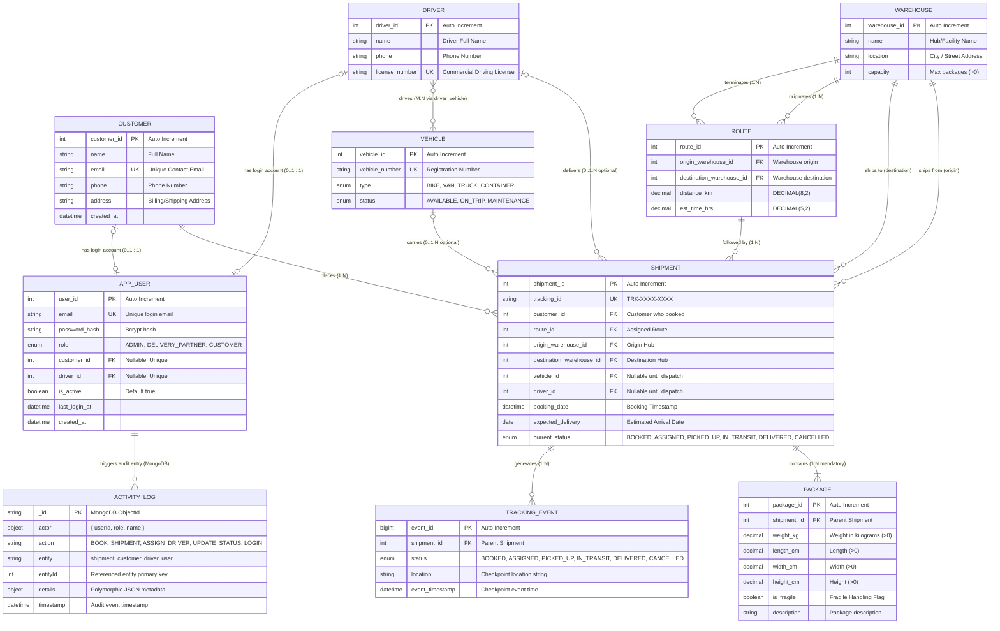

# Smart Logistics Management System — Updated Complete ER Diagram & Schema

> **Document Version:** 2.0 (Post-Audit & Multi-Role Authentication Update)  
> **Prepared for:** DBMS Mini-Project Presentation & Viva

---

## 1. What Was Missing in Your Initial Handwritten ER Diagram

| Component | Initial Handwritten Diagram | Updated Complete Architecture | Why It Was Needed |
|---|---|---|---|
| **User Authentication (`APP_USER`)** | ❌ **Completely Missing** | ✅ Added `APP_USER` entity with optional 1:1 links to `CUSTOMER` and `DRIVER` | Required for role-based security (Admin, Delivery Partner, Customer) and password hashing with bcrypt. |
| **NoSQL Audit Trail (`ACTIVITY_LOG`)** | ❌ **Completely Missing** | ✅ Added MongoDB document collection | Represents the hybrid DBMS architecture (MySQL for ACID transactions, MongoDB for append-heavy audit logs). |
| **Route Endpoints (`origin` / `destination`)** | Had generic diamond `CONNECTS` to Warehouse | ✅ Clearly specifies `origin_warehouse_id` and `destination_warehouse_id` | A route connects exactly two distinct warehouses ($origin \neq destination$). |
| **Package Dimension Breakdown** | Lumped as single `dimensions` attribute | ✅ Atomic attributes: `length_cm`, `width_cm`, `height_cm`, `weight_kg`, `is_fragile` | Complies with **1st Normal Form (1NF)** atomicity requirements. |
| **Participation Constraints** | Not indicated | ✅ Explicitly shows mandatory vs. optional participation (e.g., Driver and Vehicle are *optional* when a shipment is booked, but become *mandatory* on dispatch). | Prevents runtime foreign key violations. |
| **M:N Junction Table (`driver_vehicle`)** | Generic diamond `DRIVES` | ✅ Relational junction table with composite PK `(driver_id, vehicle_id)` and attribute `assigned_on` | Physical database representation of M:N driver-vehicle assignment. |

---

## 2. Updated Entity-Relationship (ER) Diagram (Crow's Foot Notation)



---

## 3. Classical Chen's Notation Summary (For Blackboard/Oral Viva)

If your examiner asks in terms of classical ER terminology:

### A. Entities
1. **Strong Entities**:
   - `CUSTOMER` (Key: `customer_id`)
   - `WAREHOUSE` (Key: `warehouse_id`)
   - `ROUTE` (Key: `route_id`)
   - `VEHICLE` (Key: `vehicle_id`)
   - `DRIVER` (Key: `driver_id`)
   - `APP_USER` (Key: `user_id`)
2. **Weak / Dependent Entities**:
   - `SHIPMENT` (Depends on `CUSTOMER`, `ROUTE`, `WAREHOUSE`)
   - `PACKAGE` (Weak entity dependent on `SHIPMENT` via identifying relationship `CONTAINS`)
   - `TRACKING_EVENT` (Weak entity dependent on `SHIPMENT` via identifying relationship `GENERATES`)
   - `DRIVER_VEHICLE` (Associative entity resolving M:N relationship `DRIVES`)

### B. Relationships & Cardinalities
| Relationship | Between Entities | Cardinality | Participation |
|---|---|---|---|
| **PLACES** | `CUSTOMER` &rarr; `SHIPMENT` | **$1 : N$** | Total for Shipment (every shipment must have a customer), Partial for Customer |
| **FOLLOWS** | `ROUTE` &rarr; `SHIPMENT` | **$1 : N$** | Total for Shipment |
| **ORIGINATES** | `WAREHOUSE` &rarr; `ROUTE` | **$1 : N$** | Total for Route |
| **TERMINATES** | `WAREHOUSE` &rarr; `ROUTE` | **$1 : N$** | Total for Route |
| **SHIPS_FROM** | `WAREHOUSE` &rarr; `SHIPMENT` | **$1 : N$** | Total for Shipment |
| **SHIPS_TO** | `WAREHOUSE` &rarr; `SHIPMENT` | **$1 : N$** | Total for Shipment |
| **CONTAINS** | `SHIPMENT` &rarr; `PACKAGE` | **$1 : N$** | Total on both sides (at least 1 package per shipment) |
| **GENERATES** | `SHIPMENT` &rarr; `TRACKING_EVENT` | **$1 : N$** | Total for Event, Partial for Shipment (event history grows over time) |
| **CARRIES** | `VEHICLE` &rarr; `SHIPMENT` | **$1 : N$** | Partial on both sides (assigned only after booking) |
| **DELIVERS** | `DRIVER` &rarr; `SHIPMENT` | **$1 : N$** | Partial on both sides (assigned only after booking) |
| **DRIVES** | `DRIVER` &rarr; `VEHICLE` | **$M : N$** | M:N resolved via `driver_vehicle` associative table |
| **HAS_LOGIN** | `CUSTOMER` &rarr; `APP_USER` | **$1 : 0..1$** | Partial on both sides |
| **HAS_LOGIN** | `DRIVER` &rarr; `APP_USER` | **$1 : 0..1$** | Partial on both sides |

---

## 4. Relational Schema in 3rd Normal Form (3NF)

```text
customer(customer_id PK, name, email UNIQUE, phone, address, created_at)

warehouse(warehouse_id PK, name, location, capacity)

route(route_id PK, origin_warehouse_id FK, destination_warehouse_id FK, 
      distance_km, est_time_hrs)
      CONSTRAINT: origin_warehouse_id <> destination_warehouse_id
      UNIQUE KEY: (origin_warehouse_id, destination_warehouse_id)

vehicle(vehicle_id PK, vehicle_number UNIQUE, type, status)

driver(driver_id PK, name, phone, license_number UNIQUE)

driver_vehicle(driver_id FK, vehicle_id FK, assigned_on)
      PRIMARY KEY: (driver_id, vehicle_id)

shipment(shipment_id PK, tracking_id UNIQUE, customer_id FK, route_id FK,
         origin_warehouse_id FK, destination_warehouse_id FK,
         vehicle_id FK NULL, driver_id FK NULL,
         booking_date, expected_delivery, current_status)

package(package_id PK, shipment_id FK, weight_kg, length_cm, width_cm, height_cm, 
        is_fragile, description)

tracking_event(event_id PK, shipment_id FK, status, location, event_timestamp)

app_user(user_id PK, email UNIQUE, password_hash, role, 
         customer_id FK NULL UNIQUE, driver_id FK NULL UNIQUE, 
         is_active, last_login_at, created_at)
```

---

## 5. Normalization Justification for Evaluators

1. **First Normal Form (1NF)**:
   - All attribute values are strictly **atomic** (e.g. Dimensions are decomposed into `length_cm`, `width_cm`, `height_cm` rather than a comma-separated string).
   - No repeating groups or multivalued columns; unique primary keys exist for every table.
2. **Second Normal Form (2NF)**:
   - Already in 1NF.
   - All non-key attributes are **fully functionally dependent** on the primary key. In the composite PK table `driver_vehicle(driver_id, vehicle_id)`, the attribute `assigned_on` depends on the whole composite key, not just `driver_id` or `vehicle_id`.
3. **Third Normal Form (3NF)**:
   - Already in 2NF.
   - **No transitive functional dependencies** ($X \to Y$ where $Y \to Z$ does not exist for non-prime attributes).
   - *Note on `shipment.current_status`*: Maintained automatically via an ACID database trigger on `tracking_event` insertion. This deliberate denormalization enables $O(1)$ fast lookups without forcing full historical table scans for status checks.
