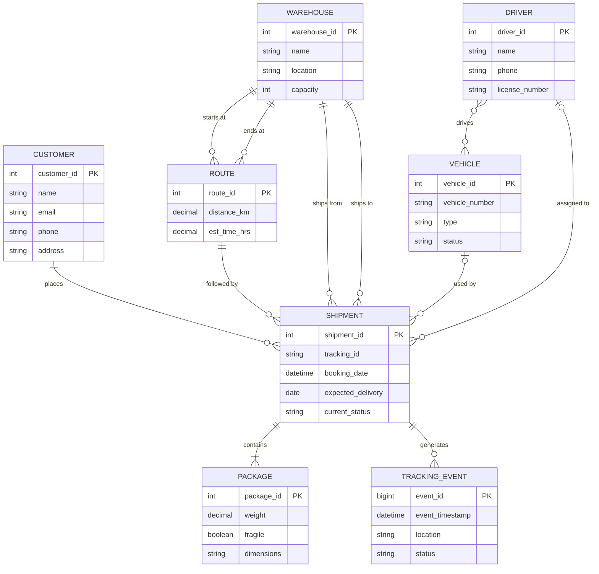

# Smart Logistics Management System — ER & Relational Schema

## 1. Entity-Relationship (ER) Diagram



---

## 2. ER to Relational Schema Mapping Rules

| Rule applied | Result |
|---|---|
| Strong entity becomes a table | `customer`, `shipment`, `package`, `warehouse`, `route`, `vehicle`, `driver`, `tracking_event` |
| 1:N puts FK on the "many" side | `shipment.customer_id`, `package.shipment_id`, `tracking_event.shipment_id`, `shipment.route_id` |
| Two relationships to the same entity use two FKs | `shipment.origin_warehouse_id` / `destination_warehouse_id`; `route.origin_warehouse_id` / `destination_warehouse_id` |
| Optional N:1 uses a nullable FK | `shipment.vehicle_id`, `shipment.driver_id` |
| M:N becomes a junction table | `driver_vehicle (driver_id, vehicle_id)` for DRIVES |

---

## 3. Relational Schema (3NF)

```text
customer(customer_id PK, name, email UNIQUE, phone, address, created_at)

warehouse(warehouse_id PK, name, location, capacity)

route(route_id PK, origin_warehouse_id FK, destination_warehouse_id FK, distance_km, est_time_hrs)

vehicle(vehicle_id PK, vehicle_number UNIQUE, type, status)

driver(driver_id PK, name, phone, license_number UNIQUE)

driver_vehicle(driver_id FK, vehicle_id FK, assigned_on)
  PRIMARY KEY (driver_id, vehicle_id)

shipment(shipment_id PK, tracking_id UNIQUE, customer_id FK, route_id FK,
         origin_warehouse_id FK, destination_warehouse_id FK,
         vehicle_id FK NULL, driver_id FK NULL,
         booking_date, expected_delivery, current_status)

package(package_id PK, shipment_id FK, weight, fragile, dimensions)

tracking_event(event_id PK, shipment_id FK, status, location, event_timestamp)
```

All relations are normalized to **Third Normal Form (3NF)**:
1. **1NF**: Atomic attributes, primary keys defined for every table.
2. **2NF**: No partial functional dependencies (all non-key attributes depend on whole composite PKs, e.g., in `driver_vehicle`).
3. **3NF**: No transitive dependencies ($X \to Y$ where $Y$ is not part of a candidate key). `current_status` on `shipment` is a deliberate trigger-maintained denormalization for fast O(1) reads without recalculating from `tracking_event` history.
